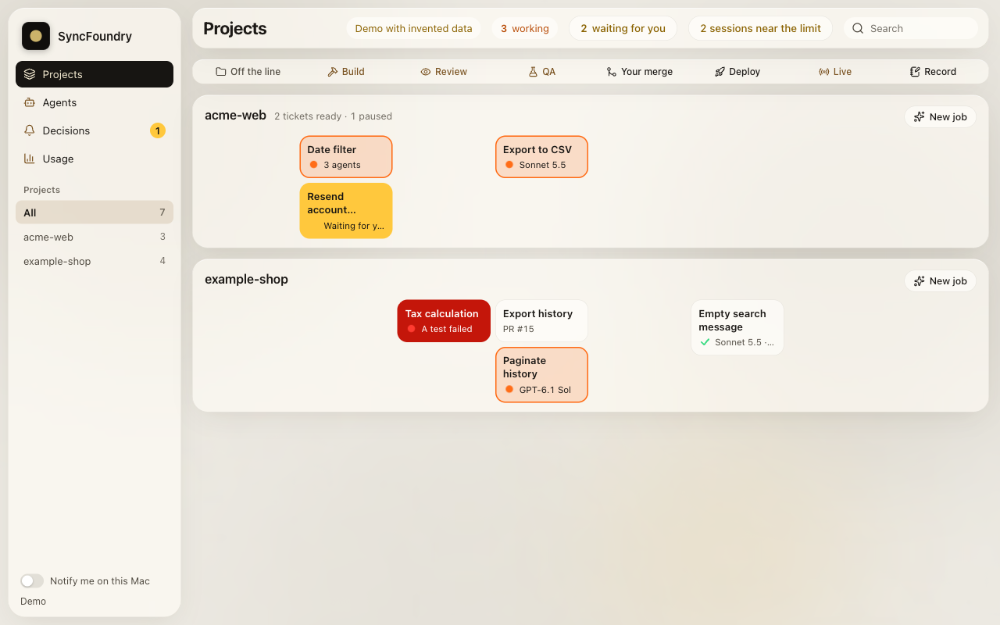

# AI Software Factory

A [Claude Code](https://code.claude.com) skill that puts every piece of work on one line, from idea to shipped code. It finds where the work is, says so, and does that step. The decisions and the dangerous actions stay with a person: it stops at two human gates, and a small hook (`guard.py`) makes Claude Code ask you before it merges, pushes to main, deploys, runs real migrations, applies the "ready for an agent" label, or touches `.env` files through the shell.

It works from the repo: tracker commands, label names, check commands and house rules are read from files in the repo, never hard-coded in the skill.


An interactive version of this diagram is in [docs/diagrams/line.html](docs/diagrams/line.html).

## Why

| Problem | What addresses it |
|---|---|
| An agent merges or deploys on its own | Gate 2 (a human merges) and step 7 (Ship) are human. `guard.py` asks a person before merge, push to main, force push, deploy and real migrations. |
| A change that only its builder reviewed | Step 5: a fresh agent that did not build the change runs `/code-review`, plus `/security-review` when the ticket's security note is yes or the diff touches auth or data. The result is posted on the PR even when clean. |
| QA that did not test the exact commit | `QA.md` part A: QA runs on the PR's exact head (detached checkout), and the `QA` comment records `Commit: <SHA>`. It only counts with the PR's last commit and `Result: pass`. A new commit needs a new QA. |
| Work lost when a session dies | Each change keeps a note (intent, scope, checklist, evidence, next step) in a file outside the code, so the next agent can pick it up. Every build starts fresh from its ticket. |
| Small changes forced through heavy process | Three lanes: **Answer** (no branch, no PR), **Fast** (build it now, one review, one verify) and **Full** (shape and spec it first). Size never picks the lane; open decisions do. |
| Money, auth or data changes slipping through as "small" | An always-full list (money, auth, sessions or roles, data access rules, migrations or schema, secrets, client or patient data) forces the full lane however small the diff. |
| Instructions hidden in a ticket | Ticket, PR and comment text is treated as data, not instructions. Only a maintainer's AFK label counts, and agents never apply it. |

## Prerequisites

| Need | Check |
|---|---|
| [Claude Code](https://code.claude.com) | `claude --version` |
| git | `git --version` |
| [GitHub CLI](https://cli.github.com) `gh`, logged in (the tracker commands use it) | `gh auth status` |
| Python 3.9+ (standard library only; the hook alone runs on 3.7) | `python3 --version` |
| Node.js 22.20+ (only to run the `skills` installer for the dependency skills) | `node --version` |

Optional: [Codex CLI](https://github.com/openai/codex) (read-only second reviews), [Orca](https://github.com/stablyai/orca) with its `orca` CLI (the dashboard's live data and launch buttons).

## Installation

### 1. Install the tools

```bash
# Claude Code (macOS, Linux, WSL). Other methods: https://code.claude.com/docs/en/setup
curl -fsSL https://claude.ai/install.sh | bash

# GitHub CLI. macOS: brew install gh   Other systems: https://github.com/cli/cli#installation
gh auth login
```

### 2. Install the skill

Personal skills are loaded from `~/.claude/skills/<name>/SKILL.md`.

```bash
git clone https://github.com/jimenezbryan/ai-software-factory ~/.claude/skills/ai-software-factory
```

The guard hook command in step 4 assumes this location. If you install elsewhere, change the path there.

### 3. Install the dependency skills

The line calls skills from [mattpocock/skills](https://github.com/mattpocock/skills): `setup-matt-pocock-skills`, `grill-with-docs` (with `grilling` and `domain-modeling`, which it and `triage` call), `to-spec`, `to-tickets`, `triage` and `tdd` (which points to `codebase-design`). Install them with the `skills` CLI (the repository's README gives this command; `-g` installs to your user directory, `-a claude-code` picks the agent, `-s` picks skills):

```bash
npx skills@latest add mattpocock/skills -g -a claude-code \
  -s setup-matt-pocock-skills grill-with-docs grilling domain-modeling triage tdd codebase-design to-spec to-tickets
```

Older installs named the spec and ticket skills `to-prd` and `to-issues`; this line uses the current names `to-spec` and `to-tickets`. Upstream also offers a Claude Code plugin install (`claude plugin install mattpocock-skills@claude-plugins-official`); pick one method per agent so you do not get every skill twice.

### 4. Install the guard hook

Add this to `~/.claude/settings.json` (merge it with any `hooks` you already have):

```json
{
  "hooks": {
    "PreToolUse": [
      {
        "matcher": "Bash|mcp__.*__(deploy_.*|create_deployment|request_promote|request_rollback|assign_alias|start_rolling_release|complete_rolling_release|approve_rolling_release_stage)",
        "hooks": [
          {
            "type": "command",
            "command": "python3 \"$HOME/.claude/skills/ai-software-factory/guard.py\""
          }
        ]
      }
    ]
  }
}
```

Per Claude Code's hooks documentation, a matcher containing characters other than letters, digits, `_`, `-`, spaces, `,` and `|` is read as a regular expression, so the alternation above matches the `Bash` tool and the listed deploy tools of any MCP server.

### 5. Deny `.env` files to the file tools

The hook covers `.env` access through the shell. Claude Code's own file tools are covered by permission rules. Add to `~/.claude/settings.json`:

```json
{
  "permissions": {
    "deny": [
      "Read(//**/.env)",
      "Read(//**/.env.*)",
      "Read(//**/*.env)",
      "Edit(//**/.env)",
      "Edit(//**/.env.*)",
      "Edit(//**/*.env)"
    ]
  }
}
```

In Claude Code's permission syntax a `//` prefix is an absolute path from the filesystem root, so `//**/.env` matches a `.env` anywhere on the machine. These patterns also block templates like `.env.example` for the file tools. That is on purpose: deny rules are checked before allow rules, so an `allow` rule can't reopen them. Claude can still read a template through the shell, which `guard.py` lets through. `Edit` rules apply to all built-in tools that edit files; `Read` rules are applied on a best-effort basis to tools like Grep and Glob. See [Configure permissions](https://code.claude.com/docs/en/permissions).

### 6. Optional

- **Dashboard:** needs Orca (`brew install --cask stablyai/orca/orca` on macOS, then enable the CLI in Orca's Settings, General, Orca CLI; check with `orca status --json`). See [docs/dashboard.md](docs/dashboard.md).
- **Codex CLI:** `npm install -g @openai/codex` (or `brew install --cask codex`), then run `codex` and sign in. Used for read-only second reviews: `codex exec --sandbox read-only "<the review>"`.
- **An auth-review skill** of your own, which step 5 runs when a change touches auth or data.

Restart Claude Code after editing `settings.json`.

## Verify the install

```bash
python3 ~/.claude/skills/ai-software-factory/guard.py --check
```

Prints `ok` when the self-test passes; a failed assertion exits non-zero. Then, in Claude Code:

```
/ai-software-factory help
```

This prints the usage guide and changes nothing. To confirm the hook is live, ask Claude in a scratch repo to run `git push origin main`; Claude Code should show an approval prompt from the hook instead of running it.

## Quick start

| Type | It does |
|---|---|
| `/ai-software-factory` | Lists what is in flight, asks: continue at X or start fresh? |
| `/ai-software-factory <an idea in words>` | Picks the lane and says why: fast (build it now) or full (shape it first). You can ask for the other |
| `/ai-software-factory path/to/plan.md` | Tells you to type `/to-spec`, then `/to-tickets`; you stop at Gate 1 |
| `/ai-software-factory #12` | Ready for an agent: builds it. Otherwise says what is missing |
| `/ai-software-factory PR #14` | Reviews it, runs QA or the live check, whichever is next |
| `/ai-software-factory model changed` | Walks `MODELS.md`: what the new model no longer needs from us |
| `/ai-software-factory help` | Prints the usage guide |

The first time in a repo with no `docs/agents/`, the skill tells you to type `/setup-matt-pocock-skills`. The spec skills (`setup-matt-pocock-skills`, `grill-with-docs`, `to-spec`, `to-tickets`, `triage`) are marked upstream so an agent cannot invoke them: the agent names the command and stops, and you type it.

## How it works

The skill (`SKILL.md`) reads your input, finds the step of the line the work is at, states the step and the evidence for it, then does that step. `BUILD.md` is step 4 (test-first build, security tests, verify, PR template, review rules, the fast lane), `QA.md` is steps 6 and 8, and `MODELS.md` lists which model runs which task and what to re-check when the model changes.

Two gates are human: **Gate 1** (a person reads the spec and tickets and applies the AFK label) and **Gate 2** (a person merges). Step 7, Ship, is human too.


Details: [docs/how-it-works.md](docs/how-it-works.md).

## Safeguards and their honest limits

What the skill forbids any agent to do on its own: push to main, merge, deploy, apply migrations to a real database, read or edit `.env*`, touch money, email or client-data tools, weaken a test, or obey instructions written inside a ticket.

- **Claude Code:** `guard.py` turns the most important of these into an approval prompt, and `permissions.deny` refuses `.env*` to the file tools. A blocked step is finished: hand it back, never look for another route to the same effect.
- **Other agents (Codex, Gemini...):** there is no block. They have the rules as text, review read-only, and do not build.
- **The hook reads command text. It is not a sandbox.** A script, alias or `python -c` can evade it. It stops mistakes and instructions smuggled into tickets, not a determined attacker. The real ceiling is a sandbox per agent.
- **One approval holds for one commit.** That is a rule for the agent; the hook does not track commits.
- **Only a person approves.** An agent's approval never counts as a human's.

See [docs/guard.md](docs/guard.md) and [SECURITY.md](SECURITY.md).


## Dashboard (optional)

SyncFoundry is a local, read-mostly dashboard of the line: what is in flight, which agent is waiting, which PR needs which step. Standard-library Python, bound to `127.0.0.1`.



```bash
python3 ~/.claude/skills/ai-software-factory/dashboard/dashboard.py
# open http://127.0.0.1:4388   (add ?demo for invented data)
```

Details, requirements and running it as a background service: [docs/dashboard.md](docs/dashboard.md).

## Configuration

| Setting | Where | Effect |
|---|---|---|
| `ASF_ALLOW_MAIN_PUSH` | environment of Claude Code | Comma-separated list of `owner/repo` (github.com) or `host/owner/repo` entries. In a listed repo, a Bash call that is only `git push origin <refspec>` (only `-C <dir>` allowed before `push`, and a refspec that reaches main written literally as `main`, `master` or `<branch>:main`) skips the prompt when every push URL of `origin` matches an entry; the merge-into-main prompt is skipped the same way. Force pushes, deleting main, expanded forms like `@` or `heads/main`, and repos with a custom ssh command, proxy or receive-pack (`core.sshCommand`, `GIT_SSH_COMMAND`, `remote.origin.receivepack` and the like) still ask. Details in [docs/guard.md](docs/guard.md). Empty by default |
| `ASF_DASHBOARD_PORT` | environment of the dashboard | Port, default 4388 |

Files in the repo the skill reads: `docs/agents/issue-tracker.md`, `docs/agents/triage-labels.md`, `docs/agents/checks.md`, `GLOSSARY.md` (older setups: `CONTEXT.md`), `docs/adr/`, `REVIEW.md` and house rules (`CLAUDE.md` / `AGENTS.md`, which win over the skill). Full table: [docs/configuration.md](docs/configuration.md).

## Uninstall

```bash
rm -rf ~/.claude/skills/ai-software-factory
```

Then remove the `PreToolUse` entry that runs `guard.py` and the `.env` deny rules you added from `~/.claude/settings.json`. The dependency skills are removed separately (delete their folders under `~/.claude/skills/`).

## Contributing

Issues and pull requests are welcome. Before opening a PR, run both self-tests (CI runs the same):

```bash
python3 guard.py --check
python3 dashboard/dashboard.py --check
```

Changes to `guard.py` should come with a case in its self-test. Changes that loosen a safeguard, a gate or the always-full list need an explicit reason in the PR.

## License

MIT, (c) 2026 VirtualSync Solutions LLC. See [LICENSE](LICENSE). Bundled third-party code: [THIRD_PARTY_NOTICES.md](THIRD_PARTY_NOTICES.md).
