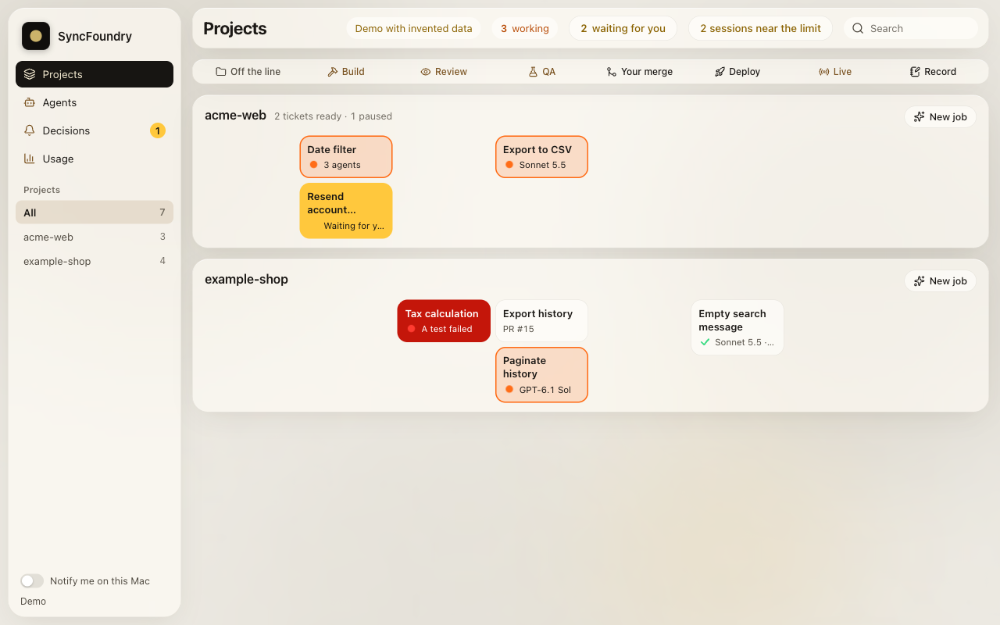

# SyncFoundry dashboard

An optional local dashboard of the line, with a plain "SyncFoundry" wordmark. It shows what is in flight and what each agent is waiting for. It is a single standard-library Python file plus a static page and two bundled libraries ([THIRD_PARTY_NOTICES.md](../THIRD_PARTY_NOTICES.md)); it loads nothing from the internet.



## Run it

```bash
python3 ~/.claude/skills/ai-software-factory/dashboard/dashboard.py
```

Open `http://127.0.0.1:4388`. Add `?demo` to the URL to see invented data instead of yours (that is how the screenshot was made). Self-test: `python3 dashboard/dashboard.py --check`.

| Variable | Effect |
|---|---|
| `ASF_DASHBOARD_PORT` | Port to listen on. Default `4388` |

## Requirements

The dashboard needs Python 3.9+ (standard library only) and `git` and `ps` on the `PATH`. Live data and the buttons use these tools, which also need to be on the `PATH` of the process that runs it:

| Tool | Used for |
|---|---|
| `orca` ([Orca](https://github.com/stablyai/orca) and its CLI), required | Listing agent terminals and worktrees, sending text to an agent, opening its terminal, launching an agent in a new worktree, answering decisions. Enable the CLI in Orca under Settings, General, Orca CLI; check with `orca status --json` |
| `gh` (optional; check with `gh auth status`) | Reading PR and review/QA state, and the tickets carrying the repo's AFK-ready label, from GitHub. Without it that data is missing. It polls about every two minutes and spends the same rate limit your agents use |

The launch button starts Claude through Orca (`orca agent launch`), so `claude` and `codex` need not be on its `PATH`. It also reads local Claude Code session files under `~/.claude/` and Codex session files under `~/.codex/sessions` for numbers and the model name, and `~/.claude/settings.json` for the compact window.

## What it does and does not do

- It shows state. From PRs it keeps only the title and the review/QA markers; from session logs only numbers and the model. It does not read prompts or specs. It does show titles and questions, which may name clients or people, so **never put it behind a tunnel or publish it**.
- Its buttons only send text to an agent, open its terminal, launch an agent in a new worktree, or answer a decision.
- **There is no merge and no deploy.** The self-test asserts that those endpoints do not exist.
- It never writes to an agent stopped at a permission prompt. That is answered in the terminal, so the guard stays in charge.
- It listens on `127.0.0.1` only. Requests that change anything must carry a per-process token (header `X-Dashboard`), a same-origin `Origin`, a matching `Host` and a JSON content type; the self-test covers requests from another website and DNS rebinding. Request bodies are capped, and a negative or non-numeric `Content-Length` is rejected with 400.
- **What that protects against, and what it does not.** The page token and the Host/Origin checks protect against *websites* (DNS rebinding and cross-site requests from your browser). They do **not** protect against other local processes or other users on the same machine: `GET /` serves the token to any local client that sends a matching `Host`, so anything that can reach `127.0.0.1:<port>` can read the token and use the buttons. Run it only on a machine you do not share.

## Run it in the background

### macOS (launchd)

Save as `~/Library/LaunchAgents/com.example.asf-dashboard.plist`, replacing `HOME_DIR` with the absolute path of your home directory (launchd does not expand `~` or `$HOME`). launchd gives agents a minimal `PATH`, so set it to include where `orca`, `gh` and `git` live.

```xml
<?xml version="1.0" encoding="UTF-8"?>
<!DOCTYPE plist PUBLIC "-//Apple//DTD PLIST 1.0//EN" "http://www.apple.com/DTDs/PropertyList-1.0.dtd">
<plist version="1.0">
<dict>
  <key>Label</key>
  <string>com.example.asf-dashboard</string>
  <key>ProgramArguments</key>
  <array>
    <string>/usr/bin/python3</string>
    <string>HOME_DIR/.claude/skills/ai-software-factory/dashboard/dashboard.py</string>
  </array>
  <key>EnvironmentVariables</key>
  <dict>
    <key>PATH</key>
    <string>/opt/homebrew/bin:/usr/local/bin:/usr/bin:/bin:HOME_DIR/.local/bin:/Applications/Orca.app/Contents/Resources/bin</string>
    <key>ASF_DASHBOARD_PORT</key>
    <string>4388</string>
  </dict>
  <key>RunAtLoad</key>
  <true/>
  <key>KeepAlive</key>
  <true/>
</dict>
</plist>
```

```bash
launchctl bootstrap gui/$(id -u) ~/Library/LaunchAgents/com.example.asf-dashboard.plist
# stop and remove:
launchctl bootout gui/$(id -u) ~/Library/LaunchAgents/com.example.asf-dashboard.plist
```

### Linux (systemd user service)

Save as `~/.config/systemd/user/asf-dashboard.service`:

```ini
[Unit]
Description=SyncFoundry dashboard

[Service]
ExecStart=/usr/bin/python3 %h/.claude/skills/ai-software-factory/dashboard/dashboard.py
Environment=ASF_DASHBOARD_PORT=4388
Restart=on-failure

[Install]
WantedBy=default.target
```

```bash
systemctl --user daemon-reload
systemctl --user enable --now asf-dashboard.service
```

Add an `Environment=PATH=...` line if `orca`, `gh` or `git` are not on systemd's default user `PATH`.
